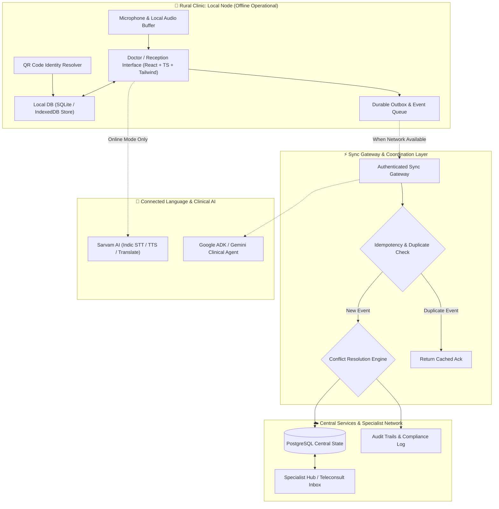
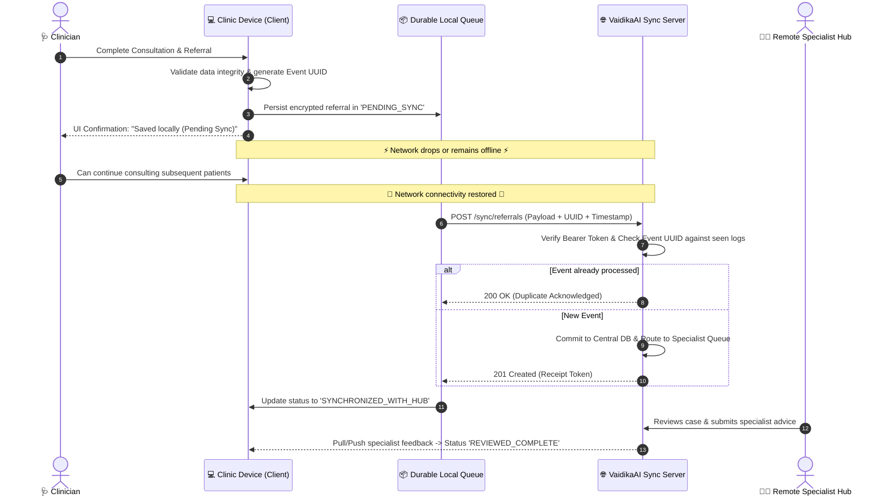

# 🏥 VaidikaAI (वैदिका AI)

> **Care continues. Even when connectivity doesn't.**  
> *A local-first, multilingual telemedicine and care-coordination platform engineered for low-bandwidth coastal and hill talukas.*  
> **DevHost 2026 · PS 3.2 Challenge Entry**

---

[](LICENSE)
[](https://react.dev/)
[](https://vitejs.dev/)
[](https://tailwindcss.com/)
[](https://fastapi.tiangolo.com/)
[-ff6f00.svg)](https://www.sarvam.ai/)
[](https://sqlite.org/)
[]()

---

## 📌 Executive Summary

**VaidikaAI** is not just another hospital management system. It is a **local-first healthcare operating system for the last mile of care**.

In rural coastal and hilly terrains across India, small clinics and frontline healthcare workers (ASHA/ANM workers, PHC doctors, mobile medical units) operate under unstable, low, or intermittent network bandwidth. Traditional cloud-only telemedicine solutions freeze, drop transactions, and lose critical consultation context when the connection cuts out.

VaidikaAI decouples local clinical operations from central cloud services:
- **Local operations never stop:** Patient registrations, triage, multilingual voice consultations, clinical note drafting, lab orders, and pharmacy dispenses persist locally on the clinic device.
- **Store-and-Forward Telemedicine:** When specialist referral or remote consultation is required, cases are queued in a durable, encrypted outbox and automatically synchronized with idempotent delivery guarantees as soon as connectivity resumes.
- **Respecting Existing Infrastructure:** Designed to complement national digital initiatives like **eSanjeevani** and **ABDM (Ayushman Bharat Digital Mission)** by solving the frontline offline continuity gap.

---

## 🎯 The Problem Statement

### 🏆 Official Challenge: PS 3.2
> **Lightweight Telemedicine Prototype for Low-Bandwidth Coastal & Hill Talukas**

### ⚠️ The Core Problem
When the internet fails, rural healthcare workflows fail with it. Frontline doctors cannot reliably coordinate specialist advice, patient records become fragmented across paper slips, and patients are forced to undertake costly, exhausting travel to district hospitals simply to repeat routine evaluations.

> **Central Design Question:**  
> *How might we make a rural healthcare consultation continue safely when the network does not?*

### 👥 Who Experiences This Problem?

| Stakeholder | Ground Reality & Bottleneck | VaidikaAI Solution |
| :--- | :--- | :--- |
| **Frontline Clinician** | Needs to consult, document encounters, request specialist reviews, and prescribe without being blocked by dead network zones. | Zero-latency local interface, automated multilingual transcription drafts, and clinician-approved record archiving. |
| **Rural Patient** | Faces linguistic barriers, travel expenses, missing paper records, and repeated clinic visits. | Clinic-issued QR identity token, Kannada/Hindi voice consultations, and localized vernacular care instructions. |
| **NGO / Health Programme** | Needs operational continuity across remote clinics and mobile vans without duplicating records or breaching privacy. | Durable peer-to-peer sync, multi-site continuity, structured audit logs, and role-based data governance. |

---

## 💡 Five Core Architectural Capabilities

```
┌─────────────────────────────────────────────────────────────────────────┐
│                           VaidikaAI Platform                            │
├─────────────────────┬─────────────────────┬─────────────────────────────┤
│ 1. Offline-First    │ 2. Multilingual     │ 3. Clinician-Controlled     │
│    Consultations    │    Voice AI         │    Structured Records       │
│ • Local SQLite/IDB  │ • Sarvam AI STT     │ • AI creates draft notes    │
│ • Token generation  │ • Kannada / Hindi   │ • Doctor reviews & approves │
│ • Queue referrals   │ • English bridge    │ • Zero hallucinated orders  │
├─────────────────────┴─────────────────────┴─────────────────────────────┤
│ 4. Store-and-Forward Referral Engine      │ 5. Shared Care Continuity   │
│ • Durable outbox with retry backoff       │ • Cryptographic QR token    │
│ • UUIDv4 idempotency (zero duplicates)    │ • ABHA & DPDP 2023 aligned  │
│ • Explicit delivery acknowledgment state  │ • Least-privilege access    │
└───────────────────────────────────────────┴─────────────────────────────┘
```

1. **Offline-First Consultation:** Complete patient registration, vitals recording, consultation drafting, and lab/pharmacy orders proceed locally without network access.
2. **Multilingual Voice Interface:** Captures the patient's voice in their native dialect (e.g., Kannada, Hindi), produces instant bilingual transcriptions, and bridges dialogue with the clinician.
3. **Clinician-Controlled Consultation Records:** AI acts strictly as an assistant. Clinical summaries, ICD-10 suggestions, and prescriptions remain editable drafts until explicitly approved and signed by the doctor.
4. **Store-and-Forward Referral:** Referrals are bundled into structured, encrypted packages stored in a durable local queue. Once connectivity returns, the payload transmits to the specialist hub and awaits explicit server acknowledgment.
5. **Shared Patient Continuity & Privacy:** A lightweight clinic-issued QR token provides rapid retrieval of local patient histories without exposing raw Aadhaar or confidential health data in plaintext.

---

## 🏛️ System Architecture



---

## 🔄 The Offline Synchronization & Idempotency Protocol

A naive offline system simply posts a cached form and hopes for the best. VaidikaAI implements a resilient **Event-Sourced Store-and-Forward Protocol**:



### 🔒 Core Synchronization Guarantees:
- **Zero Duplicate Referrals:** Every event carries an unforgeable UUIDv4. Server drops duplicates idempotently.
- **Local Persistence First:** The application writes to local disk *before* triggering UI success states.
- **Explicit Four-Stage Lifecycle:**
  `Saved Locally` ➔ `Pending Sync` ➔ `Received by Hub` ➔ `Reviewed by Specialist`
- **Zero Blind Overwrites:** Clinical edits are never merged via blind "last write wins". Divergent clinical updates trigger an explicit clinician reconciliation prompt.

---

## 🗺️ Patient Journey: The Lakshmi Walkthrough

Imagine a 52-year-old patient named **Lakshmi** visiting a rural primary healthcare centre in coastal Karnataka. Connectivity is fluctuating between 2G and dead zones.

```
01. REGISTRATION           02. MULTILINGUAL INTAKE       03. CLINICAL EXAM & REVIEW
┌───────────────────────┐  ┌──────────────────────────┐  ┌───────────────────────────┐
│ Lakshmi presents her  │  │ Lakshmi speaks Kannada:  │  │ Doctor verifies symptoms, │
│ clinic QR card. Staff │  │ "ನನಗೆ ಎದೆ ನೋವು ಮತ್ತು     │  │ reviews AI draft summary, │
│ scan/issue token.     │  │ ಉಸಿರಾಟದ ತೊಂದರೆ ಇದೆ"      │  │ orders ECG, prescribes   │
│ Works 100% offline.   │  │ Instant bilingual draft. │  │ initial medication.       │
└───────────────────────┘  └──────────────────────────┘  └───────────────────────────┘
           │                            │                              │
           ▼                            ▼                              ▼
04. OFFLINE OUTBOX         05. STORE-AND-FORWARD SYNC    06. SPECIALIST CLOSURE
┌───────────────────────┐  ┌──────────────────────────┐  ┌───────────────────────────┐
│ Specialist referral   │  │ Once connection blinks   │  │ District Cardiologist     │
│ queued in local       │  │ on, payload transmits to │  │ reviews ECG, sends advice.│
│ encrypted storage.    │  │ hub with zero loss or    │  │ Clinic receives closure   │
│ Marked 'Pending Sync'.│  │ duplicate submissions.   │  │ in patient's record.      │
└───────────────────────┘  └──────────────────────────┘  └───────────────────────────┘
```

---

## 📂 Project Structure

```
VaidikaAI/
├── v1/                           # 🌐 Modern Frontend Client (React 18 + Vite + TS)
│   ├── src/
│   │   ├── components/           # Reusable UI & domain components
│   │   │   ├── shared/           # PortalNav, QRScannerBox, PatientCard, SeverityBadge
│   │   │   └── ui/               # Radix UI + Tailwind design system
│   │   ├── pages/                # Multi-role portals
│   │   │   ├── Index.tsx         # Portal Dashboard
│   │   │   ├── DoctorPage.tsx    # Doctor Consultation, Voice & Referral Hub
│   │   │   ├── ReceptionPage.tsx # Patient Intake & QR Issuance
│   │   │   ├── RecordsPage.tsx   # Master Patient Longitudinal Records
│   │   │   ├── LabPage.tsx       # Diagnostics & Test Orders
│   │   │   └── PharmacyPage.tsx  # Dispense Verification
│   │   ├── lib/                  # State management & offline store
│   │   │   ├── patientStore.tsx  # Offline-first state machine & mock dataset
│   │   │   └── types.ts          # Core domain models (Visits, Patients, Referrals)
│   │   └── App.tsx               # Client routes & providers
│   └── package.json
│
├── api/                          # ⚡ Gateway & Microservices (FastAPI)
│   ├── main.py                   # Voice transcription, consult parsing & sync API
│   └── __init__.py
│
├── voice/                        # 🎙️ Multilingual Indic Voice Engine
│   ├── voice_handler.py          # Sarvam AI STT & translation pipeline
│   ├── sarvam_client.py          # Sarvam REST client wrapper
│   ├── interactive_consultation.py# Live microphone stream processor
│   └── test_microphone.py        # Diagnostic microphone validation script
│
├── agents/                       # 🤖 Clinical Decision Support Agents
│   ├── consultation_agent.py     # Gemini / ADK structured clinical note synthesizer
│   ├── main_agent.py             # Orchestration agent for clinical workflows
│   └── schema.py                 # Pydantic schemas for clinical summaries
│
├── pipelines/                    # 🔄 Pipeline Orchestration (Apache Airflow)
│   └── dags/
│       └── example_dag.py        # Batch synchronization & analytics DAG
│
├── data/                         # 📊 Big Data & Analytical Store
│   ├── spark_jobs/               # PySpark batch ETL routines
│   └── delta/                    # Delta Lake storage partition
│
├── docker-compose.yml            # Multi-container local orchestration
├── requirements.txt              # Python service dependencies
├── .env.example                  # Environment configuration template
└── README.md                     # Project blueprint & documentation
```

---

## 🛡️ Security, Privacy & Compliance (DPDP 2023 & ABDM)

1. **Non-Meaningful QR Identifiers:**
   - QR cards embed only an opaque, cryptographically random lookup token (`VK-2025-XXXXX`).
   - Sensitive medical history, Aadhaar, and PAN are **never** encoded in plain text.
2. **Consent-Mediated Sharing (ABDM Alignment):**
   - Follows Ayushman Bharat Digital Mission (ABDM) guidelines: clinical records are retained under provider custody and federated only upon verified consent.
3. **Data Protection Principles (DPDP Act 2023 / DPDP Rules 2025):**
   - Purpose limitation, storage minimization, local encryption at rest (AES-256 for offline stores), and TLS 1.3 in transit.
   - Granular role-based access control (Doctor, Reception, Lab, Pharmacy) preventing privilege escalation.

---

## 📊 Measurable Pilot Targets

| Impact Area | Metric | Target |
| :--- | :--- | :--- |
| **Offline Reliability** | Workflows completed with zero connectivity | **≥ 95%** in controlled stress tests |
| **Data Integrity** | Events synchronized without loss or duplication | **100%** in automated chaos suites |
| **Referral Delivery** | Queued referrals acknowledged by receiving hub | **≥ 95%** upon network reconnect |
| **Documentation Speed** | Reduction in time to generate approved consultation notes | **20% to 35% faster** |
| **Linguistic Usability** | Clinician satisfaction with Kannada/Hindi translations | **≥ 85%** acceptance rate |

---

## 💼 Business & Sustainability Model

VaidikaAI serves a double bottom-line: social impact with viable unit economics.

### 💰 Revenue Streams
1. **Clinic SaaS Tier (₹499 – ₹1,500/month/site):** Lightweight subscription for standalone clinics covering software updates, local backups, and encrypted synchronization.
2. **NGO & Health Mission Licensing (₹15,000 – ₹75,000/month):** Multi-site fleet management for mobile healthcare vans, rural trusts, and public health pilots with centralized dashboards.
3. **Integration & Telemedicine Hub Retainers:** Custom connectors for district specialty hospitals and diagnostic networks receiving high-volume structured referrals.

---

## 🚀 Quick Start Guide

### Prerequisites
- **Node.js** 18+ & `npm`
- **Python** 3.10+ (for API and voice modules)
- **Docker & Docker Compose** (optional for full multi-service deployment)

### 1. Clone & Configure
```bash
git clone https://github.com/Cal2-0/VaidikaAI.git
cd VaidikaAI

# Copy environment template
cp .env.example .env
```

Set your API keys in `.env`:
```ini
SARVAM_API_KEY=your_sarvam_api_key
GOOGLE_API_KEY=your_gemini_api_key
DATABASE_URL=sqlite:///./vaidika.db
```

---

### 2. Run Frontend Client (`v1`)
```bash
cd v1
npm install
npm run dev
```
👉 Open browser at: **`http://localhost:5173`**
- **Doctor Portal:** Consultation, voice notes, symptom chips, prescriptions, referrals
- **Reception:** Instant patient intake and QR code badge generation
- **Master Records:** Longitudinal patient history
- **Lab & Pharmacy:** Order processing and medication dispensing

---

### 3. Run FastAPI Backend & Voice Engine
```bash
# In project root
python -m venv venv
# On Windows:
.\venv\Scripts\activate
# On Linux/macOS:
source venv/bin/activate

pip install -r requirements.txt
uvicorn api.main:app --host 0.0.0.0 --port 8000 --reload
```
👉 API Docs available at: **`http://localhost:8000/docs`**

---

### 4. Or Run Full Stack via Docker
```bash
docker-compose up --build
```
| Service | URL |
| :--- | :--- |
| **Agent API** | http://localhost:8000 |
| **Voice Service** | http://localhost:8001 |
| **Airflow Orchestrator** | http://localhost:8080 |
| **Spark Master Dashboard** | http://localhost:8082 |

---

## 🧪 Testing Network Interruption (Demo Protocol)

To verify the offline resilience during a live demonstration or judging session:
1. **Register a Patient & Record Consultation:** Open `http://localhost:5173/reception` and create a patient token.
2. **Simulate Connection Cut:** Disconnect Wi-Fi or toggle DevTools `Network -> Offline`.
3. **Prescribe & Queue Referral:** Move to `http://localhost:5173/doctor`, add symptoms, write notes, and order a specialist referral.
4. **Inspect Local Outbox:** Note that all records persist in local state with status `Pending Sync`. Refreshing the browser preserves all data.
5. **Restore Network:** Turn Wi-Fi back on. The sync queue automatically flushes and delivers the payload to the receiving hub with zero duplicate records.

---

## 👥 DevHost 2026 Team

- **VaidikaAI Engineering Team** — *DevHost 2026 · PS 3.2 Track*

---

## 📄 License

This project is licensed under the **MIT License** — see the [LICENSE](LICENSE) file for details.
